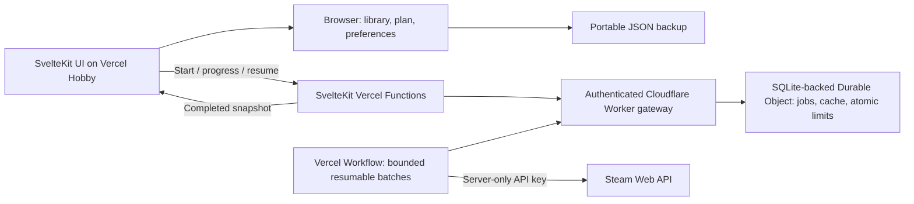

# Superseded: durable backend proposal

Historical record only. The user chose a simpler browser-driven backend on
2026-11-14. Use [the current plan](../sveltekit-and-steam-import.md).
The Cloudflare/Workflow requirements below are not first-release requirements.

# SvelteKit migration, UI refresh, and direct Steam imports

Status: Svelte UI migration and browser library storage implemented locally on
2026-11-09. Direct imports, queues, caching, and API limits remain planned.
Updated: 2026-11-14. Vercel Hobby and browser-local data with portable backups
are the agreed first-release direction. This document describes the target; it
does not imply that planned backend or backup features are implemented.

## Outcome

Achievement Atlas becomes a SvelteKit app with a polished shadcn-svelte interface.
A visitor pastes their Steam profile link, clicks **Import library**, watches
progress, and gets their dashboard. Returning visits load the saved library from
the browser. Refresh is explicit. No account, personal API key, Python install,
or file upload is required for the normal flow.

Keep JSON import/export and the Python collector as fallback tools. No separate
SQL service, account system, or cross-device sync in the first release. Cloudflare
Durable Objects use SQLite internally through their key/value API. The user explicitly
prefers migrating to Svelte and refreshing the UI as part of this work.

## Agreed decisions and implementation status

- Target $0 hosting on the existing Vercel Hobby project. No Pro upgrade or paid
  dependency is assumed. Revisit costs only with measured usage and an explicit
  decision; hitting a free allowance should pause imports rather than enable billing.
- Keep the first release personal/noncommercial, without accounts or cloud sync.
- Save libraries and custom plans in the browser. Provide one easy combined JSON
  backup and restore flow for recovery and moving between browsers/devices.
- Refresh only on user request, with cooldowns, incremental collection, shared
  metadata caches, and server-enforced budgets. Keep demo and file imports available.
- Preserve the existing production origin so existing browser data remains accessible.

Implemented locally on November 9: SvelteKit UI, refreshed views/charts, an active
library snapshot in IndexedDB, per-SteamID plans in localStorage, and existing plan
import/export. The UI uses 50-row pagination, not virtualization. Checks and browser
verification are recorded in [ui-verification.md](../ui-verification.md). Changes are
still uncommitted and no deployment was recorded as of the November 14 review.

Remaining: combined backup/restore, transactional library-and-plan persistence,
server collector, resumable execution, shared storage, live import/refresh UI,
limits, backend verification, and deployment. Earlier phase checklists below are
requirements, not a claim that every baseline measurement or migration step passed.

## Starting point and scope

The original app was React 18 + Vite + TypeScript, with React TanStack adapters,
Recharts, custom CSS, and localStorage persistence. There is no backend.

Reuse the framework-independent code in `src/types.ts` and `src/lib/{steam,
optimizer,derive,format,plan}.ts`. Separate storage from plan calculations.
Port the React components, views, hooks, and PlanContext to Svelte. Replace
Recharts with shadcn-svelte chart components built on LayerChart; use compatible
Svelte TanStack adapters for table behavior and virtualization.

This is a medium UI migration, not a dependency swap. The main uncertainty is
chart interaction and virtualized-table parity, not the completion calculations.
Choose and pin mutually compatible stable package versions when implementation
starts; do not mix examples from different SvelteKit/TanStack major versions.

## Architecture

The earlier long-running Node service proposal is superseded. Use the existing
Vercel adapter and short, resumable import batches with persisted checkpoints.
No batch may depend on staying alive beyond the function deadline. Execution is
at least once: a crash after Steam responds but before checkpointing can require
another upstream request. Make persisted effects idempotent; count each dispatched
retry as a new attempt, and never refund ambiguous attempts. Test crashes before
dispatch, after the Steam response, and after checkpoint commit.

Selected implementation: Vercel Workflow plus one Cloudflare SQLite-backed Durable
Object accessed through a small authenticated Worker gateway. Workflow handles
long-lived orchestration; the DO provides strongly consistent control state and
bounded binary snapshot/metadata storage. Cloudflare Turnstile supplies the free
bot challenge. No Upstash or Redis dependency is required. See the
[readiness decision record](../free-tier-readiness.md) for provider evidence and local
spike results. No paid resources have been provisioned.

Each upstream attempt is charged through the DO before dispatch. Lease fencing,
profile generations, byte reservations and manifest pointers are authoritative in
the same object. Use short transactions; return eligibility times instead of
waiting in the DO. Cache TTL is implemented with expiry checks and bounded indexed
alarm cleanup, not assumed to exist as a Redis feature.

Use the official Workflow SvelteKit plugin; its local build/smoke test passed.
Cloud deployment still requires generated-route/auth checks. Browser-driven
continuation is a documented contingency only; it would pause with the tab closed
and require an explicit UX change. No detached promises or process-local queues.

The browser holds the durable personal library and plan. Server storage contains
short-lived import results, a bounded 30-day refresh baseline cache, shared game
metadata, and operational state. The baseline cache stores the latest successful
public snapshot per active profile, not history or achievement plans; see retention
and access rules below. API keys
live only in server secrets and server-only modules. SSR renders the public shell;
browser storage loads after mount, with an explicit loading state. Personal state
must never be stored in a shared server module variable.

## Combined backup and local-data experience

The browser is the primary home for personal data, not a guaranteed backup.
Clearing site data, browser eviction, private browsing, a lost device, or changing
origin can make it unavailable. Another browser/device starts independently.
Steam data can be fetched again; a custom plan cannot be reconstructed from Steam.

- Put **Export backup** and **Restore backup** in an easy-to-find data/settings area.
  Explain: “Saved in this browser. Export a backup to keep a copy or move devices.”
- Export one dated JSON file with an explicit format identifier, schema version,
  export timestamp, library snapshot/freshness metadata, SteamID-associated plans,
  and an allowlist of useful preferences. Include locally retained plans for other
  profiles with their IDs; do not imply their library snapshots are retained today.
- Exclude app API keys, cookies, job/refresh capabilities, and internal operational
  metadata. Process backups entirely in the browser, without uploading them.
  A restored backup needs no Steam/server request once the app is loaded; a subsequent refresh without a capability
  follows the normal budgeted import path.
- Validate size, schema/version, profile IDs, plan targets, and preferences before
  changing anything. Preview the profile/date and explain replacement. Offer an
  export of current data before confirmation; do not silently merge or overwrite.
- Commit library, plans, and preferences in one versioned IndexedDB transaction. Migrate existing localStorage plans only after verifying
  their durable replacement. A failed restore leaves the previous data intact.
- Keep legacy collector JSON and plan-only imports supported with clear labels.
  Reject unsupported future backup versions with a useful error, not partial writes.
- Show saving failures and offer export of the in-memory data. Request persistent
  browser storage where supported, without treating permission as a guarantee.
- Show last backup time and a quiet reminder after plan changes; no blocking nags.
  Provide local-data deletion with an export opportunity. Keep local deletion and
  capability-protected server-cache deletion distinct and explain their scope.

For v1, “local” does not promise offline reopening. Opening/reloading the app or
loading uncached views/artwork may require internet; no service worker exists.
Backup processing itself and browsing already-loaded data require no Steam calls.

The restore preview describes a full dataset replacement: active snapshot, all
retained profile plans, and allowlisted preferences. Identify existing profiles
that will be replaced/removed. Empty plans and a backup without an active snapshot
are valid. Switching the active profile during restore is allowed after this
preview; a plan-only import for the wrong profile is rejected. Validate supported
versions, SteamID syntax and embedded identity agreement, duplicate achievement
IDs, finite values, and bounded strings/counts. Use separate strict versioned
parsers and explicitly identified legacy parsers. Plans for other profiles do not
require a locally retained snapshot.

Export reads one consistent IndexedDB transaction; when saving failed, offer a
clearly marked export of the current in-memory state. Do not report a backup as
saved to disk merely because a download was initiated.

Every browser mutation checks an expected dataset revision inside its transaction.
On conflict, reload and ask the user to retry; never silently clobber another tab.
Broadcast commits to other tabs and close database connections on versionchange.
Keep a local deletion generation so a stale tab or pending import cannot recreate
deleted data. Restore and refresh must also check profile identity and revision.

Migrate all legacy plan keys, active snapshot, and preferences together; verify a
read-back before marking migration complete. Distinguish absent, corrupt, and
unavailable data. Never fall back to obsolete legacy data after verified migration
or deletion. Offer a recovery export for invalid legacy records. Delete local
snapshot, every plan, preferences, capabilities, and legacy sources together;
offer server-cache deletion before discarding its capability and report failure
separately. Browser deletion cannot remove downloaded backups.

Acceptance: round-trip library, plans, and preferences on a clean browser; restore
with network disabled after required app code has loaded; preserve old data on malformed, oversized, future-version,
wrong-profile, or interrupted input; handle denied/quota-full storage; migrate old
plans; interrupted/repeated migration; two-tab edits, restore during refresh, and
deletion during import; ensure backups contain no capabilities or secrets. Profile switching must
never mix plans, and restored stale snapshots must retain honest timestamps.

## Infrastructure decision record

See [free-tier readiness and review](../free-tier-readiness.md) for the November 14
account inspection, provider evidence, measured export sizes, chosen candidate
stack, conservative pilot limits, and independent-review findings. Its pilot
limits are the operative configuration; the 80,000-call figure is only an outer
Steam allowance safety ceiling. Backend enablement still requires the documented implementation checks.

## Free-hosting budget and remaining decisions

Checked against Vercel documentation on November 14, 2026: Hobby includes 1 million
function invocations/month, 4 active CPU-hours, 360 GB-hours of provisioned memory,
and a 300-second function ceiling with Fluid compute. Network waits consume memory
time even when they do not consume active CPU. Standard function payloads have a
4.5 MB limit; use bounded chunks or supported streaming for large result downloads.
Do not send full browser backups to a function. These are plan allowances, not an
app capacity guarantee; account usage by other projects reduces available headroom.
Hobby is for personal/noncommercial use. Exceeding limits can pause features until
allowances recover. Recheck provider terms and actual remaining usage before release.

Provider selection and technical defaults are resolved in the readiness record:
Vercel Workflow + Cloudflare Workers Free/SQLite DO + Turnstile. Remaining work is
authenticated account setup and actual implementation validation: team allowance
headroom, secrets, a cloud preview, representative resource measurements, and a
free alert destination before broad rollout. No payment is needed to continue.
The limited pilot can use manual provider Usage/Logs checks; do not imply alerting
is configured. The account inspection could not read Hobby usage and no connected
browser was available, so remaining headroom is explicitly unknown.

No further product decision is needed now. Implement the documented design and
bring back only a real cost requirement or material experience tradeoff. Do not
activate paid fallback billing. Track all provider allowances as well as Steam
calls, stop admission with headroom, and show clear retry guidance. App counters
do not guarantee protection from all public-request costs; provider exhaustion
can pause imports and available edge protections should reject abuse early.

Release order: finish combined backups and migration → validate free infrastructure
and costs → implement full imports with checkpoint recovery → add incremental
refresh and admission limits → staging tests and limited rollout on the existing
origin. If live-import resources are exhausted, keep the saved-data experience,
demo, and local file tools usable wherever hosting availability permits.

## UI direction

Open the [interactive HTML preview](../ui-preview.html) for the proposed overview,
game detail panel, plan controls, filters, and import/refresh states. All data and
progress in the preview are illustrative; it makes no Steam requests.

Use shadcn-svelte as a foundation for inputs, buttons, tooltips, dialogs, sheets,
menus, tabs, progress, skeletons, tables, and chart framing. Preserve the product's
Steam identity while improving readability, hierarchy, and mobile behavior.

Initial design tokens to validate in the first vertical slice:

- Canvas `#18212D`, surface `#243244`, text `#F0F4F8`, muted text `#ACBDCE`,
  action blue `#78C9F2`, achievement gold `#E8BE65`.
- Source Sans 3 for headings and body, self-hosted if adopted; tabular numerals
  for counts and percentages. Validate contrast for every actual pairing.
- Left-aligned workspace; compact desktop navigation; readable mobile navigation.
  Use game artwork and achievement icons as the distinctive visual material.
- Reserve color for actions, completion, rarity, and planned changes. Keep labels,
  icons, and numerical values so meaning does not depend on color alone.

Screen changes:

- Landing: one profile field and **Import library**, with **Try demo** and
  **Import JSON** secondary. Explain public Game details and local saving nearby.
- Import: stages for profile lookup, library loading, and achievements; show actual
  completed-game counts, useful retry guidance, and an honest queued state.
- Overview: readable profile summary, completion and next actions, then trends.
  Display last successful sync and a refresh action with cooldown information.
- Achievements/library: sticky search/filter toolbar, clear sortable columns,
  virtualized large lists, and mobile layouts that retain important fields.
- Plan: persistent desktop side panel and mobile sheet, visible projected impact,
  accessible add/remove controls, and preserved export/import actions.
- Charts: shared typography, labeled units, consistent tooltips, responsive sizing,
  meaningful empty states, reduced motion, and textual summaries.

Port both existing area charts, rarity bars, the completion distribution, and
playtime/completion scatter. Verify the scatter tooltip names the correct game,
handles overlapping points and touch, and does not clip at container edges.
The shadcn examples are a starting point; use LayerChart primitives where required.
Keep chart code out of the import landing bundle. Virtualization is a separate
requirement from adopting the shadcn table styles.

## Implementation phases

### 1. Baseline and SvelteKit foundation

- Preserve the existing working changes and establish a reproducible React baseline.
- Record demo outputs for completion, optimizer, plan impact, and chart datasets.
  Add focused regression cases, including duplicate/stale plan items after refresh.
- Capture desktop/mobile behavior and production bundle sizes. Measure dashboard
  load, search/filter interaction, and scrolling with demo and larger fixtures.
- Scaffold SvelteKit and shadcn-svelte on a migration branch. Keep existing CSS
  during the port where useful; introduce shared tokens and components deliberately.
- Build a vertical slice: landing → JSON import → profile overview → one virtualized
  list → scatter chart. Resolve library compatibility and interaction issues here.

Exit: existing export data renders correctly in the Svelte slice; chart and table
approach is proven. No live API integration needed yet.

### 2. Complete migration and UI refresh

- Port overview/trends, achievements, library, optimizer, explanation/onboarding,
  and all plan interactions. Preserve rarity views and game achievement drill-down.
- Replace React context/hooks with per-app Svelte state and derived calculations.
- Refresh layout and styling screen by screen using the direction above.
- Preserve demo, keyboard operation, focus return, mobile drawer behavior,
  filtering/sorting, downloads, and malformed-file handling.
- Remove React, React adapters, and Recharts after feature parity. Retain lazy
  loading for heavy chart code; avoid bundling both chart stacks in the release.

Exit: all current workflows work in Svelte; numerical parity and browser tests
pass. Report measured performance differences rather than promise a speedup.
Svelte may reduce framework overhead; it does not accelerate Steam requests.

### 3. Reliable browser persistence

- Add a versioned IndexedDB storage layer for snapshots and plans keyed by SteamID.
  Keep small display preferences in localStorage where appropriate.
- Migrate existing library and per-profile plan keys once, validate the write,
  then mark migration complete. Retain legacy data until recovery is verified.
- Preserve the current origin for automatic migration; if the domain changes,
  provide export/import instructions because browser storage cannot cross origins.
- Make writes transactional. A failed import or refresh must not replace a valid
  snapshot. Show when saving is unavailable and offer an export instead.
- Restore after reload; support replacing the active profile and deleting local
  data. Keep plans separated by profile and reconcile unlocked/missing targets
  so a refresh cannot inflate projected completion. Retain missing/unavailable
  targets as inactive and exclude them from projections; never silently destroy
  custom intent. Only an authoritative successful achievement response may mark a
  target complete. Keep completed/inactive targets in backups until the user clears
  them. An older snapshot import does not authorize destructive reconciliation.

Exit: old users retain data/plans, large exports persist, and blocked storage
still permits a session with a visible warning. No cross-device syncing implied.

### 4. Server-side Steam collection

- Implement a TypeScript collector with the existing SteamData contract. Use
  mocked Steam responses for parity; retain Python as the independent fallback.
- Normalize SteamID64/vanity/profile links and only call fixed Steam API hosts.
- Add timeouts, bounded retries with backoff, bounded concurrency, and error
  categories for invalid profile, privacy, rate limit, and upstream outage.
- Treat missing achievement responses as unknown/error, not zero achievements.
  Do not publish an incomplete snapshot as a complete replacement.
- Implement full imports first, then incremental refresh before public release,
  using the algorithm below. Cache metadata shared across users: suggested
  initial TTLs are seven days for schemas/icons and 24 hours for global rarity.
  Cache only valid responses; allow schema invalidation for missing achievements.
- Add durable job progress/checkpoints, leases, restart recovery, bounded result
  sizes, and expiry. Completed snapshots expire after one hour; expire terminal
  job metadata after 24 hours. Refresh baselines expire 30 days after the last
  successful user-requested refresh, subject to a global byte/entry cap. Eviction
  falls back to a full import. Reuse active jobs for the same profile internally.

Proposed API: `POST /api/imports` starts work; `GET /api/imports/:id` polls status;
`GET /api/imports/:id/result` downloads the completed snapshot (chunked or streamed
when required). If using browser-driven execution, add capability-protected
`POST /api/imports/:id/continue` to advance one bounded batch (not enabled in the
selected Workflow design). Require an opaque,
high-entropy import capability for status/result access; keep it out of URLs and
logs. This is temporary job access, not proof of Steam account ownership.
Use `Cache-Control: no-store` for personal job responses.

Exit: real public-profile import works in staging, unavailable/private data is
explained, and worker restart never silently produces an incomplete result.

### 5. Connect the experience and protect the shared allowance

- Wire profile input, progress, successful save, last-sync time, and refresh.
  Keep the previous dashboard usable during refresh and errors.
- Start with a six-hour per-profile refresh cooldown, layered admission limits,
  limited active jobs, and a bounded queue. Use the concrete defaults below;
  all enforcement is server-side and shared across instances.
- Count every outbound attempt, including retries and metadata calls, against
  atomic persistent rolling-24-hour counters. Start with the pilot caps of 1,000 attempts per rolling 24 hours and 20,000
  per rolling 30 days. Keep 80,000/day only as an outer safety ceiling below
  Steam's published 100,000/day allowance; all infrastructure limits apply first.
- Reserve only the next bounded batch before running, not an entire large library,
  and enforce the budget at each call.
  If allowance is insufficient, defer with a clear retry time instead of
  repeatedly hammering Steam. If the limit store fails, pause new imports.
- Apply global pacing and respond to HTTP 429 with backoff. The published daily
  allowance does not guarantee a safe burst rate.
- Validate same-origin browser requests, request size, trusted proxy/IP handling,
  and job capability access. No account does not mean an unlimited public proxy.
- Update privacy copy: Steam data is processed temporarily by our server;
  libraries and plans persist in this browser, and the latest public snapshot is
  also cached for up to 30 days to make refresh cheaper. State retention, cache
  eviction, deletion controls, and hosting region.
  Ask people to import their own profile; a pasted URL does not verify ownership.
- Log timings, request counts, cache hits, queue depth, and sanitized errors.
  Do not log API keys, capability tokens, full Steam URLs with secrets, or snapshots.

Exit: browsing saved data uses no Steam API calls; repeated refreshes cannot
bypass the cooldown; budget protection works across service restarts.

### 6. Verify and release

- Run TypeScript/Svelte checks, production build, collector/data regression tests,
  and browser checks on desktop and mobile.
- Test valid import, private and empty libraries, invalid vanity, 429/5xx,
  partial game failure, worker restart, quota exhaustion, and expired job access.
- Verify the abuse and refresh acceptance cases below with a mocked upstream
  call counter, controllable clock, and concurrent workers.
- Test localStorage migration, storage denial, reload during import, same-file
  re-import, profile switching, refresh/plan reconciliation, and backup restore.
- Inspect built assets/network traffic for secret exposure. Verify imported
  personal data never appears in a public cached SSR response.
- Compare production JS transfer and UI responsiveness against phase 1 using
  identical fixtures and browser conditions. Investigate regressions before release.
- Deploy with an import feature flag. Start with a few requested imports and
  watch the allowance/cache behavior. Keep JSON import available if live imports
  need to be disabled. Document rollback and required server secrets.

## Durable execution and publication contract

- Persist pending-start and a durable coordinator alarm before accepting work.
  Alarm-driven authenticated dispatch retries uncertain starts with bounded backoff,
  stable job/start identity, and a recorded run ID. Verify the pinned SDK's atomic
  start hook in preview; duplicates must still converge on one leased job. Exhausted
  dispatch retries surface an operator-recoverable state, not silent abandonment.
- Keep waiting jobs in the DO, not ten independently polling workflows. A single
  dispatcher starts eligible work; schedule the actual next-eligible time. Quota
  pauses resume automatically within the seven-day job lifetime; expired jobs or
  exhausted dispatch retries need explicit user/operator recovery. Daily/monthly
  exhaustion does not create an unbounded backlog. Never silently truncate data.
- The DO has one shared alarm scheduler for dispatch and expiry cleanup. Choose the
  earliest due task and process bounded work; the two concerns must not overwrite
  each other's alarm. Account for alarm invocations and storage writes.
- Use per-batch reservations, unique per-attempt gates, lease fencing, and checkpoint
  revisions. If a batch reaches its deadline, commit completed items, leave unknown
  items pending, and continue later. Reserve status/result/cleanup headroom even
  after new admissions stop. All retries and rejected requests have bounded cost.
- Write immutable result chunks and verify their checksums and sizes before an
  atomic manifest-pointer publication. An incomplete manifest is never visible.
  Garbage-collect abandoned chunks; pin/re-extend referenced chunks for the full
  manifest lifetime and verify them on download. Polls read compact progress only.
- Server cache deletion or a privacy failure increments a profile generation,
  invalidates capabilities, cancels pending jobs, and invalidates result manifests.
  Every commit checks generation and fencing so sleeping/stale workers cannot
  resurrect deleted data. Remove chunks asynchronously with bounded retries after
  logical access revocation. Recheck Steam visibility before a new import session
  can consume a cached snapshot; do not expose cached data through dedupe alone.
- Sanitize step errors as well as logs: provider workflow history can retain errors,
  inputs and outputs. Workflow arguments/results contain only opaque internal job
  IDs and small nonpersonal progress, never snapshots, API keys, capabilities, or
  upstream credential-bearing URLs. State provider retention limits in privacy copy.
- Turnstile verification checks hostname/action/expiry and binds the token hash to
  one session/admission identity atomically for its validity window. Repeated calls
  may retry that admission only; concurrent validations cannot create extra jobs.

## Capacity and later improvements

The local 205-game export has 158 games with achievement data. The current
collector would make approximately 526 requests without caches, or 210 when all
shared metadata is cached, excluding retries and optional vanity resolution.
These are planning estimates, not guaranteed throughput. Caching complete browser
snapshots means normal repeat visits need no calls.

Incremental refresh is a first-release requirement, implemented after full imports
and before rollout. Defer Steam OpenID, cloud history, account recovery, and
cross-device plans until demand justifies them. OpenID proves identity; it does
not authorize access to private game details.

## Abuse prevention and popularity spikes

These are proposed starting defaults to tune using observed legitimate use, not
Steam-published burst allowances. No anonymous endpoint can guarantee that every
request is human. Hard outbound and infrastructure limits bound the damage even
if an attacker bypasses challenges or rotates IP addresses.

### Admission and execution

1. Apply edge request/body limits before expensive parsing or cache access. Accept
   only supported profile references, cap their length, and normalize to SteamID
   before per-profile deduplication. Vanity resolution itself consumes the budget;
   rate-limit/cache it and briefly cache definitive invalid-name responses.
2. Issue a signed anonymous browser session cookie. Start with three new job starts
   per session per hour and ten per day, plus a broader IP ceiling of ten per hour
   and thirty per day. These are configurable; shared networks need clear retry
   messages. Clearing cookies must not reset IP/profile/global limits. Trust only
   platform-validated forwarding headers. Short-retention hashed IP keys are still
   operational personal data and belong in the privacy disclosure.
3. Require a server-verified bot challenge for expensive first imports, suspicious
   traffic, and all new work during surge mode. Verify expiry, site/action binding,
   and replay protection. Cache hits and ordinary dashboard use need no challenge.
   Same-origin checks and CORS help browser isolation but do not stop direct scripts.
4. Allow one active job per SteamID; idempotency keys make retries reuse the job.
   Serialize profile refreshes across browser sessions and worker instances.
   Do not expose another requester's job capability when deduplicating work.
5. Start with one executing job and at most ten queued jobs. Limit total upstream
   concurrency to two requests and pace globally at an initial two calls/second,
   lowering throughput on 429s. Use bounded retry counts and a circuit breaker for
   sustained Steam errors. Job count and request pacing are independent controls.
6. Limit progress polling to once every ten seconds per job capability, thirty
   seconds for short queues; stop hidden-tab polling and honor Retry-After for
   quota waits. Never poll until a daily/monthly quota resets. Bound result sizes, downloads,
   cache bytes, job lifetime, and log volume as well as Steam calls. A large valid
   library can be checkpointed across runs; never silently truncate its results.
7. Use atomic budget reservation and a per-call gate for every worker, retry,
   cache revalidation, and profile lookup. Count an attempted upstream call before
   dispatch and do not refund it after ambiguous timeouts. Reconcile unused job
   reservations with leases without refunding already-used allowance. Control-store
   eviction/restart must not erase enforcement counters; persist/protect them and
   pause imports if their integrity is unknown.

The pilot daily/monthly caps and every infrastructure allowance are enforced
together. The 80,000-call rolling-24-hour cap is an outer ceiling only. Report budget,
cache-hit rate, queue age, 429 rate, and calls per completed job in operator metrics.
Make alerts available at 50%, 75%, and 90% of the internal budget; configure an
actual notification destination at deployment, not just dashboard counters.

### Graceful behavior under load

- At 75% of any active daily/monthly pilot budget, enable surge mode: challenge new jobs,
  prioritize small incremental refreshes, and reduce admission for expensive cold
  imports. Use weighted fairness and aging so large jobs are not starved forever.
- At the hard internal cap, defer upstream work with a next-eligible estimate.
  Do not accept an unbounded backlog. Cached dashboards, demo, and file import
  remain usable; the UI explains that fresh imports are temporarily limited.
- Provide an operator kill switch for new Steam requests, edge blocking for clear
  abuse, capped worker scaling, and provider spend alerts/hard caps where supported.
  Challenge-service failure should pause challenge-required work, not bypass it.
- If legitimate demand regularly exceeds the budget, improve cache coverage and
  reduce refresh frequency before increasing infrastructure. More workers do not
  increase Steam's allowance. Contact Valve about higher-volume access; do not
  rotate keys to evade limits or assume a paid quota upgrade is available.
- Steam sign-in can become an optional abuse-control escalation for expensive
  imports, but remains outside the initial account-free experience.

## Incremental refresh algorithm

### Trusted baseline and retention

Maintain the latest successful snapshot plus a per-game manifest in the bounded
server cache: SteamID, appid, playtime, last-played value when supplied, schema
version/hash, and successful achievement-check timestamp. Track profile metadata,
global rarity, library check, and full verification timestamps separately. Browsers
retain their own complete snapshot and plan in IndexedDB.

Give the browser an opaque refresh capability, stored locally, to access its
baseline; it is not a Steam login and does not prove ownership. Do not accept a
client-supplied list of arbitrary game IDs as authority to spend API calls, or
trust client timestamps/data as the shared cache baseline. Restrict work to games
returned by Steam and validated server records. Missing/expired baseline or lost
capability falls back to a budgeted full import; this tradeoff is acceptable.

Retain at most one baseline per profile for up to 30 days, enforce a byte/entry cap,
and provide a capability-protected delete-cache action. Never cache plans or
credentials. Cache hits must not extend retention forever. On a privacy/access
failure, stop serving the server snapshot and delete or invalidate the baseline;
leave the user's existing local copy alone with a clear status message. Before
returning cached personal data in a new import session, recheck Steam visibility.
Internal sharing/deduplication must not make cached snapshots publicly enumerable.

### Refresh steps

1. During the six-hour cooldown, serve the browser's existing snapshot without
   contacting Steam. A page reload does not trigger refresh. Show the next allowed
   time and last successful checks.
2. Once eligible, fetch the current library and recently played games. Resolve
   vanity only when necessary; use the known SteamID for later refreshes. Refresh
   profile/badge metadata at most daily and avoid unused fields such as bans if
   they serve no product purpose.
3. Select games that are new, have changed playtime/last-played values, appear in
   recently played results, previously failed, or have a changed cached schema.
   Also select games not successfully checked for seven days. Recent play is a
   hint, not a complete achievement change feed; offline unlocks, resets, and game
   updates can occur without a useful playtime delta.
4. Fetch player achievements only for that union. Reuse fresh shared schemas,
   icons, and rarity; collapse simultaneous metadata misses for the same app into
   one request. Refresh stale shared entries once, not once per visiting user.
   Definitive empty schemas may be cached briefly (initially 24 hours); transient
   errors and privacy failures must never become 'no achievements' cache entries.
5. Merge successful results with the trusted baseline. Drop games removed from a
   successful authoritative library response; do not interpret a failed or hidden
   response as an empty library. If selected games fail, preserve the last good
   values and mark them stale/failed. Do not advance their successful-check times.
6. Commit the candidate snapshot and manifest atomically with a version check.
   Return freshness metadata and per-game warnings alongside the compatible
   SteamData payload. Browser replacement checks the local revision and is transactional; reconcile plan
   targets without deleting unmatched targets or treating stale responses as unlocks. A quick refresh must not claim every game was
   reverified, and a partial refresh must not masquerade as fully successful.
7. When checks are over seven days old, include a full reconciliation on the next
   requested refresh, scheduling within the same limits. No automatic background
   sweeps across inactive profiles. Offer an explicit full recheck, rate-limited
   to once per profile per 24 hours and subject to admission/budget controls.

No game is permanently skipped just because it was once 100% complete: games can
add achievements. A missed seven-day reconciliation due to capacity remains
visibly overdue, rather than being labeled fresh. This optimization trades exact
instantaneous freshness of every game for fewer calls, with full recheck available.

### Cost targets and acceptance checks

For the existing 205-game library, a warm refresh with three selected games could
use about five calls: one library request, one recently-played request, and three
achievement requests. Compared with the previous roughly 210-call warm full scan,
that is about 98% fewer calls **for that scenario**, excluding due metadata,
profile updates, retries, and scheduled full reconciliation. Measure actual counts
in tests and production rather than guarantee that saving on every refresh.

Required mocked acceptance cases:

- Reopening a saved dashboard or refreshing during cooldown: zero Steam calls.
- Warm baseline, three selected games, fresh metadata: exactly five calls;
  unchanged non-due games receive no achievement calls.
- New game, changed playtime, recent play without changed playtime, failed prior
  game, changed schema, and overdue timestamp each trigger the expected check.
- Achievement reset without playtime change is caught by full reconciliation.
- Fifty simultaneous requests for one profile create one collection job; shared
  schema cache misses also produce one request per app.
- Cookie resets, IP rotation, vanity aliases, force-refresh flags, malformed IDs,
  challenge replay, and forged forwarding headers cannot bypass the appropriate
  profile/global controls. Per-IP limits alone are explicitly insufficient.
- Concurrent workers near the cap cannot overspend; every retry counts; expired
  leases release only unused reservations. Store outage stops upstream dispatch.
- Queue saturation, poll floods, oversized results, and expired capabilities have
  bounded cost and clear errors. Server restart preserves budget and checkpoints.
- Partial responses preserve last-good values and honest timestamps. Older jobs
  cannot overwrite newer versions; privacy changes invalidate server reuse.
- Baseline expiry/eviction takes the documented full-import path; cache deletion
  works without an account; plans never enter server storage.

## Vercel observability and deployment decision

If the API runs in Vercel Functions, use project Observability for external Steam
request traffic, timing/failures, and function health. Emit structured sanitized
job-summary logs for import type, calls attempted, retries, metadata cache hits,
queue delay, and completion status. Check feature availability, retention, and
pricing against the selected Vercel plan before enabling paid observability.
Custom monitors can alert on supported Observability query results; arbitrary
application fields are not automatically available as native dashboard metrics.

The Durable Object counters are authoritative for the rolling Steam budget and queue
state. Initially emit allowance remaining, queue depth, queue wait, and refresh savings
in structured job-summary logs. Defer a protected operator page until needed. Customer accounts remain unnecessary;
operator access must be authenticated or deployment-protected, not merely hidden
at an obscure URL. Structured logs are useful for diagnosis, not quota enforcement.
A paid log/trace drain is deferred; use included logs and manual usage checks for
the limited pilot, then select a free alert route before broader release.

Vercel Hobby is the selected hosting target; the long-running Node-worker proposal
is superseded by the resumable architecture above. Validate the runner and storage
against free allowances before provisioning. Steam calls made outside Vercel need
separate instrumentation. This plan provisions no services or paid features.

References: [Observability insights](https://vercel.com/docs/observability/insights),
[structured application logs](https://vercel.com/kb/guide/add-structured-application-logs-to-vercel-functions),
[custom monitors](https://vercel.com/changelog/create-custom-monitors-in-vercel-observability).

## Sources and implementation references

- [SvelteKit server endpoints](https://svelte.dev/docs/kit/routing)
- [Vercel Hobby allowances](https://vercel.com/docs/plans/hobby)
- [Vercel function limits](https://vercel.com/docs/functions/limitations)
- [Vercel compute accounting](https://vercel.com/docs/functions/usage-and-pricing)
- [Vercel plan eligibility](https://vercel.com/pricing)
- [SvelteKit server-only modules](https://svelte.dev/docs/kit/server-only-modules)
- [shadcn-svelte charts / LayerChart](https://www.shadcn-svelte.com/docs/components/chart)
- [shadcn-svelte data tables / TanStack](https://shadcn-svelte.com/docs/components/data-table)
- [Steam API terms and daily allowance](https://steamcommunity.com/dev/apiterms)
- [Steam visibility requirements](https://partner.steamgames.com/doc/webapi/IPlayerService#GetOwnedGames)
- [Steam OpenID](https://steamcommunity.com/dev)
