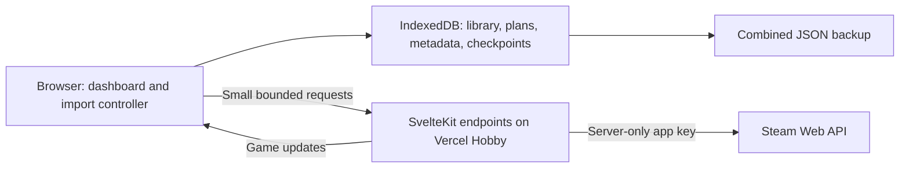

# Minimal backend, browser-owned data, and direct Steam imports

Updated 2026-11-14 following the user's simplification decision.
Status: implemented locally on 2026-11-14, including the minimal backend, combined
backups, resumable browser imports, and conditional leave-page warning. Not deployed.
See [migration verification](migration-verification.md) for current test results and rollout gates.

## Guiding rule and scope

**Keep it simple first; add complexity only in response to a demonstrated need.**

Use the existing SvelteKit app on Vercel Hobby plus short server endpoints for Steam
requests. The browser owns the library, achievement plans, cached metadata, and
import progress. Imports run while the page is available. Continuing after the tab
closes is explicitly not required.

No Cloudflare, Redis, Vercel Workflow, durable server queue, hosted database,
shared snapshot cache, accounts, or cross-device sync in v1. No paid hosting upgrade.
The earlier durable-backend proposal is
[archived](archive/durable-backend-plan-2026-11-14.md), not an implementation backlog.
The [readiness review](free-tier-readiness.md) records which earlier findings still
apply. Keep the existing production origin to preserve browser data.

## Current implementation

Implemented locally: SvelteKit/shadcn-svelte UI; two bounded Steam endpoints;
IndexedDB library, all profile plans, preferences, freshness and checkpoints;
versioned backup/restore; conditional leave-page warning; serialized saves and
cross-tab conflict protection; explicit recovery and deletion. LocalStorage is
migration input only. Changes remain uncommitted and undeployed. The HTML drafts
remain illustrative; use the running app for testing. Earlier November 9 results
are historical; current evidence is in [migration verification](migration-verification.md).

## Architecture and normal flow

1. Returning visitors immediately load their saved library. Opening a dashboard
   never automatically makes Steam requests.
2. A user pastes a profile reference, uploads an export, or chooses Refresh.
   JSON files are parsed in the browser; they are not uploaded to the backend.
3. A server endpoint resolves the profile and fetches the authoritative public
   library. Return a short-lived signed permission bound to that SteamID and the
   allowed game IDs. Keep the signing secret and Steam key server-only. Bound the
   permission's size and lifetime; support large libraries without oversized requests.
4. Compare the current library with a small browser-held manifest: game IDs,
   playtime, last-played values when available, metadata version, and last successful
   achievement-check times. Quick refresh selects new/changed/recently played games;
   retrying previously failed operations is explicit. Overdue games are reported,
   not silently added to a library-wide sweep. Imported data is a freshness hint, not authority
   for unrestricted API access. Unknown timestamps require verification.
5. The browser requests small batches of allowed games. The server validates the
   permission and requested subset, calls only fixed Steam API endpoints, and returns
   bounded results. Use explicit metadata-missing/stale flags to fetch schemas/icons
   or rarity only when needed locally. No public arbitrary URL or arbitrary API proxy.
6. Persist each successful batch, per-operation completion, attempt count, and remaining
   work in IndexedDB before requesting
   another. Stage a new import separately from the last good dashboard. At completion,
   publish the new snapshot transactionally and reconcile plans without deleting intent.
7. If interrupted, show Resume or Restart next visit. Resume revalidates the current
   library and obtains fresh permission if needed; reuse already-saved results where
   appropriate. A save failure pauses further requests and offers retry/export.

Uploaded or browser data may be modified by a user. Validate it, but do not claim
client timestamps, cooldowns, or signed replayable permissions enforce a global
budget. A modified client can request more refreshes; the limitations below are
an explicit tradeoff of keeping v1 stateless.

## Refresh and cache behavior

- Reuse metadata already present in the active library. No sharing between users.
  A separate cross-profile metadata cache/deduplication layer is deferred.
- For already-selected games, refresh missing metadata; stale schemas (seven days)
  and rarity (twenty-four hours) may be refreshed within the displayed estimate.
  Metadata expiry alone never selects additional games or launches a background sweep.
- Mark progress older than seven days as overdue and offer an explicit full recheck
  with a call estimate. Complete games remain eligible: achievements can be added.
  Quick refresh does not claim to verify unchanged/overdue games.
- Use a six-hour ordinary UI refresh cooldown initially, preserved on reload.
  Show estimated work before starting; broad/full checks require an explicit action.
  Uploading a file, loading a dashboard, focus, and token expiry never auto-refresh.
- A fresh browser with no export does a cold import. Uploaded exports seed local
  metadata; incomplete or unverifiable freshness causes more checking, not data loss.
- Preserve prior values on transient or partial errors and show stale/failed state.
  A private/failed library response is not an empty library. Only a successful
  authoritative response can establish that a game was removed or an unlock occurred.
- Retain missing/unavailable targets as inactive, excluded from projections but
  included in backups. Completed/inactive targets are removed only by the user.

## Leaving, saving, and interruptions

Use the browser's beforeunload confirmation while an import/refresh is running,
a local write is pending, or edits have failed to save. Remove the handler after
work finishes or is explicitly paused and all data is saved. Ordinary browsing
should not trigger it. For navigation controlled by our app, use a clear in-app
confirmation or keep the controller mounted if switching dashboard views is safe.

The browser supplies the dialog text; custom wording is not supported. Showing it
requires prior user interaction, and it is not reliable on mobile app kills, crashes,
or forced browser shutdown. It is a convenience warning, not the data-safety mechanism.
[Browser behavior](https://developer.mozilla.org/en-US/docs/Web/API/Window/beforeunload_event).

Display “Keep this tab open while importing,” progress, and Pause/Cancel controls.
Checkpoint as work completes, never wait until unload to save. On visibilitychange,
stop scheduling new batches while hidden; finish/checkpoint an in-flight response
when possible. On return, offer continuation. Do not promise background progress
in a hidden/suspended tab. No sendBeacon or detached background work to finish imports.

If the user chooses to leave anyway, no further browser batches are scheduled.
An already-dispatched server request may still finish; aborting fetch is best effort
and does not undo Steam calls. Saved checkpoints and the last complete library remain.
On reopening, retry unconfirmed work safely; duplicate upstream reads may occur.

## Combined backup and local-data experience

The browser is the primary home for personal data, not a guaranteed backup.
Clearing site data, browser eviction, private browsing, a lost device, or changing
origin can make it unavailable. Another browser/device starts independently.
Steam data can be fetched again; a custom plan cannot be reconstructed from Steam.

- Put **Export backup** and **Restore backup** in an easy-to-find data/settings area.
  Explain: “Saved in this browser. Export a backup to keep a copy or move devices.”
- Export one dated JSON file with an explicit format identifier, schema version,
  export timestamp, library snapshot/freshness metadata, SteamID-associated plans,
  and an allowlist of useful preferences. Include locally retained plans for other
  profiles with their IDs; do not imply their library snapshots are retained today.
- Exclude app API keys, cookies, temporary import permissions, and internal operational
  metadata. Process backups entirely in the browser, without uploading them.
  Restoring a backup needs no server request once the app is loaded. A subsequent
  refresh obtains a new short-lived import permission.
- Validate size, schema/version, profile IDs, plan targets, and preferences before
  changing anything. Preview the profile/date and explain replacement. Offer an
  export of current data before confirmation; do not silently merge or overwrite.
- Commit library, plans, and preferences in one versioned IndexedDB transaction.
  Migrate existing localStorage plans only after verifying their durable replacement. A failed restore leaves the previous data intact.
- Keep legacy collector JSON and plan-only imports supported with clear labels.
  Reject unsupported future backup versions with a useful error, not partial writes.
- Show saving failures and offer export of the in-memory data. Request persistent
  browser storage where supported, without treating permission as a guarantee.
- Provide local-data deletion with an export opportunity; there is no persistent
  server cache in v1. Automatic backup reminders are deferred.

For v1, “local” does not promise offline reopening. Opening/reloading the app or
loading uncached views/artwork may require internet; no service worker exists.
Backup processing itself and browsing already-loaded data require no Steam calls.

The restore preview describes a full dataset replacement: active snapshot, all
retained profile plans, and allowlisted preferences. Identify existing profiles
that will be replaced/removed. Empty plans and a backup without an active snapshot
are valid. Switching the active profile during restore is allowed after this
preview; a plan-only import for the wrong profile is rejected. Validate supported
versions, SteamID syntax and embedded identity agreement, duplicate achievement
IDs, finite values, and bounded strings/counts. Use separate strict versioned
parsers and explicitly identified legacy parsers. Plans for other profiles do not
require a locally retained snapshot.

Export reads one consistent IndexedDB transaction; when saving failed, offer a
clearly marked export of the current in-memory state. Do not report a backup as
saved to disk merely because a download was initiated.

Every browser mutation checks an expected dataset revision inside its transaction.
On conflict, reload and ask the user to retry; never silently clobber another tab.
Broadcast commits to other tabs and close database connections on versionchange.
Keep a local deletion generation so a stale tab or pending import cannot recreate
deleted data. Restore and refresh must also check profile identity and revision.

Migrate all legacy plan keys, active snapshot, and preferences together; verify a
read-back before marking migration complete. Distinguish absent, corrupt, and
unavailable data. Never fall back to obsolete legacy data after verified migration
or deletion. Offer a recovery export for invalid legacy records. Delete local
snapshot, every plan, preferences, temporary permissions, and legacy sources together.
There is no server snapshot to delete in v1. Browser deletion cannot remove
downloaded backups.

Acceptance: round-trip library, plans, and preferences on a clean browser; restore
with network disabled after required app code has loaded; preserve old data on malformed, oversized, future-version,
wrong-profile, or interrupted input; handle denied/quota-full storage; migrate old
plans; interrupted/repeated migration; two-tab edits, restore during refresh, and
deletion during import; ensure backups contain no temporary permissions or secrets. Profile switching must
never mix plans, and restored stale snapshots must retain honest timestamps.

## Minimal backend limits and operational tradeoffs

Use two endpoints, `POST /api/steam/start` and `POST /api/steam/batch`, one browser
controller, and one staged snapshot. Keep a simple state machine: idle, running,
paused, complete, failed. No scheduler, polling endpoint, receipt chain, generalized
job framework, or background worker is needed.

### Prevent accidental API amplification

- Acquire one origin-wide Web Lock before profile lookup or dispatch. A second tab
  shows that an import is active instead of starting one. If Web Locks are unavailable,
  use file import initially rather than implementing a second lease mechanism.
  One storage owner handles checkpoint/restore/delete revisions. Pause or invalidate
  in-flight work before restore/profile switch/deletion; an old response cannot commit.
- Dispatch one browser request at a time, with at least five seconds between batch
  starts. Each batch requests at most five distinct games. Deduplicate IDs. Reuse
  saved successful achievement/schema/rarity operations rather than rerunning the
  whole game when only one component failed.
- Track an attempt ledger in the local checkpoint. Before dispatch, reserve that
  request's worst-case attempts in IndexedDB; if persistence fails, do not dispatch.
  Settle to actual attempts only after a validated response. A lost/ambiguous response
  keeps its full reservation. Count setup, vanity, library, metadata, and all explicit
  retries—not just achievement calls. Resume, reload, and permission renewal keep
  the ledger; a new import is an explicit user action, never an error-recovery loop.
- Pause before a new request's worst-case reservation would exceed the current
  1,000-attempt import allowance. At the limit, require explicit review. Show used
  calls and remaining estimated work. Continuing explicitly grants another bounded
  allowance and preserves the cumulative total; never auto-reset the counter.
  This catches ordinary client bugs, not malicious clients or aggregate user traffic.
- No automatic server or browser retries in v1. On a timeout, transport error, 429,
  authentication failure, or transient 5xx, return completed work and pause. Stop
  further upstream calls immediately on systemic errors. Respect Retry-After, but
  countdown expiry does not resume automatically. Explicit Resume retries unresolved
  operations only; permanent unsupported/private/oversized items do not retry in a loop.
- A response with neither completed work nor a meaningful terminal/error transition
  pauses the controller. Never keep asking for continuation when no progress is made.
- Estimate calls as setup + selected achievement checks + missing/stale schema calls
  + missing/stale rarity calls. Explain this is an estimate, and show actual counted
  attempts. The old 205-game cold estimate is ~526 calls, below the initial local
  threshold; it is not a guaranteed cost. Do not copy the Python collector's four
  attempts per failed call or its long timeouts into the web collector.

### Bound each server invocation

Initial constants, centralized in one module and verified with mocked large inputs:

- At most twenty total outbound Steam attempts per invocation, including setup and
  any future retries; this means calls, not games. At most one upstream call at a
  time and two call starts/second per invocation (our pacing, not Steam's guarantee).
- Eight-second upstream timeout, twenty-five-second application deadline, explicit
  thirty-second function maximum. Do not start another call unless its timeout and
  response/checkpoint overhead fit the remaining deadline. Return bounded partial
  results instead of running until forced function termination.
- Maximum 64 KiB incoming JSON (including signed permission), 2 MiB per upstream
  response read before JSON parsing, and 2 MiB serialized aggregate response target.
  Validate bounded string lengths/counts and permission size. If the verified library
  or a single game cannot fit, stop with a clear size-limit/file-collector fallback;
  do not add complex server streaming/pagination merely for v1. Never silently truncate.
- Invalid, expired, disallowed, or oversized requests make zero Steam calls. Check
  origin/content type and signatures before fetching. Fixed Steam hosts/endpoints only.
  Tokens go in bounded POST bodies, never URLs/logs. Treat them as replayable scope
  permissions, not ownership proof or a consumable global quota allowance.
- Keep only profile/library/progress and metadata endpoints needed by the dashboard.
  Do not fetch bans, badges, levels, or other collector extras unless an existing UI
  actually needs them. Missing optional fields must be represented honestly.

Keep the app key private and imports disabled by default. Configure Vercel Hobby's
one included WAF fixed-window rate-limit rule across **both** `/api/steam/*` endpoints
before enabling the pilot: initially twenty requests per IP per sixty seconds,
returning 429. Verify enforcement, remaining rule/usage allowance, normal-client
pacing, and shared-network behavior in staging. The rule is not configured yet.
[Vercel WAF limits](https://vercel.com/docs/vercel-firewall/vercel-waf/rate-limiting).

The WAF counts requests by region; the app's batch limit bounds work per allowed
request. Neither is an exact daily global Steam cap. Same-origin checks, signatures,
local counters, and in-memory function counters cannot provide that guarantee.
Use sanitized batch logs and a tested import-enabled configuration switch.

Without shared durable state we cannot enforce an exact global daily Steam budget,
strict cross-device cooldowns, or a globally serialized import queue. This supersedes
the previous plan's hard global-cap guarantee. Start with a small manually monitored
pilot for a small deliberate audience, inspect provider usage and Steam errors,
and disable live imports if needed. Before broad anonymous rollout, explicitly
reassess aggregate usage; if reliable global protection is needed, add the smallest
shared limiter first. Do not advertise that v1 cannot exhaust the shared key.
If sustained public traffic or abuse requires stronger enforcement, the first
increment is a small shared rate-limit store—not automatically the archived full
workflow architecture. Do not quietly add dependencies or claim hard caps exist.

Vercel Hobby remains the target. Account usage headroom could not be verified by CLI;
check dashboard Usage before deployment. No Cloudflare login is required. Required
server configuration is an app-owned Steam key, a permission signing secret, import
feature flag and per-request limits. Ordinary previews use mocked Steam responses.
No personal snapshots/plans persist on the server; requests may contain profile and
game identifiers, so document that processing and avoid logging personal payloads.

## Implementation order and acceptance

1. Finish atomic local storage and combined backup/restore, including profile identity,
   revision checks, migration, and preservation of inactive targets.
2. Implement and test the bounded TypeScript Steam collector behind server-only
   endpoints. Preserve the compatible SteamData format and Python/file fallback.
3. Add the browser batch controller, local checkpoints, incremental selection,
   progress, pause/resume, save-failure handling and conditional leave-page warning.
4. Test valid/private/empty/large libraries, bad input, expired/tampered permissions,
   429/5xx, timeout, interrupted requests, partial responses, and bounded retries.
   Verify client-supplied game IDs cannot escape the signed Steam-derived scope.
   With a mocked upstream counter, assert: double click/two tabs produce one stream;
   429 causes no later call in that batch; timeouts/5xx have no automatic retries;
   failed rarity does not repeat successful progress/schema; duplicate IDs do not
   multiply calls; permission renewal/reload retain budgets; ambiguous responses
   keep reservations; no-progress responses pause; limits stop before dispatch.
   Warm refresh with one changed game must not touch metadata for unrelated games.
5. Browser tests: close/reload warning when busy, no warning when saved/idle, canceled
   navigation continues, confirmed navigation stops scheduling, reload offers explicit Resume from saved
   work, and forced termination remains recoverable without relying on the warning.
   Include hidden-tab pause, denied/full storage, multi-tab conflicts, and backup
   restore during an import. No need to implement an offline app shell for v1.
6. Run Svelte checks, focused data/collector tests, production build, and a small
   Vercel preview. Check secret isolation, generated endpoints, live request timings,
   payload sizes, WAF enforcement and usage before rollout on the existing origin. Never call earlier
   Workflow/DO experiments validation of this different backend.

Measure cold and warm refreshes before adding caching infrastructure. Add server
coordination only for observed abuse/capacity needs; add durable job execution only
if users actually need imports to survive closing the tab. Full offline reopening,
accounts, cross-device sync and a custom operations dashboard remain deferred.

## Frontend companion

The [frontend plan](frontend-plan.md), [interactive screen drafts](frontend-preview.html),
and [design review](frontend-review.md) cover onboarding, dashboard information hierarchy,
import/recovery states, local-data safety, responsive behavior, and implementation slices.
These are simulated design artifacts, not implemented backend features.
